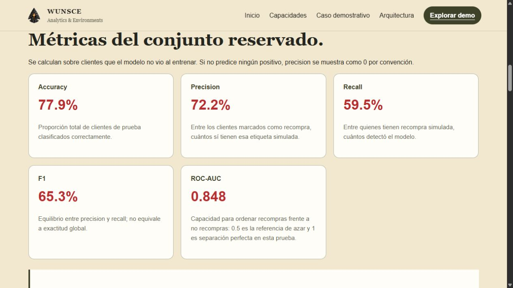
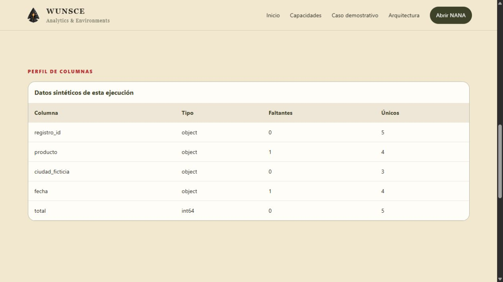

# Juan Serena · Data Science & Python

Construyo aplicaciones en Python para preparar datos, evaluar modelos y organizar procesos. Mi trabajo conecta **análisis de datos, machine learning y desarrollo backend**, con una línea de investigación en física computacional.

**Python · SQL · pandas · scikit-learn · Flask · FastAPI · PyTorch**

**[Abrir el laboratorio interactivo en Railway ↗](https://juan-serena-data-lab-production.up.railway.app/)**

[Cortex 3D](https://juan-serena-data-lab-production.up.railway.app/#cortex) · [Movilidad urbana](https://juan-serena-data-lab-production.up.railway.app/#movilidad) · [Espectros ópticos](https://juan-serena-data-lab-production.up.railway.app/#espectros) · [Indicadores STIX](https://juan-serena-data-lab-production.up.railway.app/#stix)

[Explorar los proyectos](#proyectos-destacados) · [Catálogo completo](CATALOGO.md) · [Perfil de GitHub](https://github.com/JuanSeCe1402)

**[CV y trayectoria](docs/cv/CV.md) · [CV en español](docs/cv/CV_Juan_Serena_Data_Science_ES.pdf) · [English résumé](docs/cv/CV_Juan_Serena_Data_Science_EN.pdf) · [LinkedIn](https://www.linkedin.com/in/juan-manuel-serena-cece%C3%B1a-503b98197/)**

## Proyectos destacados

### DARWIN · Del historial de compras a una señal de recompra

Predicción de recompra con **transacciones reales de UCI Online Retail II**: historial de 180 días, horizonte de 30 días y evaluación temporal de entrenamiento, validación y prueba. Compara modelos con una referencia constante y un ranking por compra reciente. Incluye fuente, licencia, limpieza auditable y resultados reproducibles.

**Python · pandas · scikit-learn · Flask**

*Captura de una ejecución sintética. Sus métricas describen esa simulación, sin acreditar precisión sobre clientes reales.*

**[Ver caso con datos reales](proyectos/darwin/datos-publicos/README.md) · [Probar demo sintética](https://wunsce-darwin-production.up.railway.app/app) · [Leer código](proyectos/darwin/README.md)**

### NANA · De un CSV desordenado a datos preparados para analizar

Un flujo de transformación con encabezados normalizados, detección de duplicados, perfil de columnas y exportación CSV/SQLite. Conserva identificadores y deja los casos ambiguos disponibles para revisión.

**Python · pandas · SQLite · Flask**

**[Probar demo](https://wunsce-nana-production.up.railway.app/app) · [Leer caso y código](proyectos/nana/README.md)**

### ESCULAPIO · Agenda, permisos y atención humana

Una aplicación administrativa con agenda, roles, conversación y transición a atención humana. El código incluye restricciones de reservas, control de versiones de citas y pruebas de concurrencia.

**Python · FastAPI · SQLAlchemy · SQLite · Jinja**

*Demo aislada con alias ficticios e integraciones externas desactivadas.*

**[Probar demo](https://wunsce-esculapio-production.up.railway.app/demo) · [Leer caso y código](proyectos/esculapio/README.md)**

## Más demos para explorar

**[Applied Data Lab](https://juan-serena-data-lab-production.up.railway.app)** reúne cuatro herramientas de costos 3D, movilidad urbana, espectros ópticos e indicadores STIX. Puedes usar los ejemplos sintéticos y procesar archivos dentro del navegador.

[Ver las cuatro demos y su alcance](CATALOGO.md#demos-en-línea) · [Código y pruebas](demos-web/README.md)

## Investigación y otros trabajos

**[Bioimpedancia: simulación e inferencia de parámetros](proyectos/bioimpedancia/README.md)** conecta modelos físicos, generación sintética y aprendizaje automático. Incluye una arquitectura PyTorch y una evaluación con particiones fijas, normalización de entrenamiento y referencia básica. Es investigación exploratoria; la ejecución pequeña comprueba el flujo y no valida el modelo físico.

También puedes explorar **[FREY: costos y márgenes](proyectos/frey/README.md)**, **[TIKAL: operaciones de negocio](proyectos/tikal/README.md)** y **[métodos numéricos](proyectos/metodos-numericos/README.md)**, o consultar las **[31 líneas de trabajo](CATALOGO.md)**.

## Evidencia y revisión técnica

La incorporación cuenta con **375 casos aprobados localmente** y workflows de GitHub Actions. Cada proyecto explica cómo ejecutarlo, qué se comprobó y sus límites. Las demos públicas utilizan datos ficticios.

[Validación](VALIDACION.md) · [Procedencia y atribuciones](PROCEDENCIA.md) · [Próximos pasos](ROADMAP.md)
