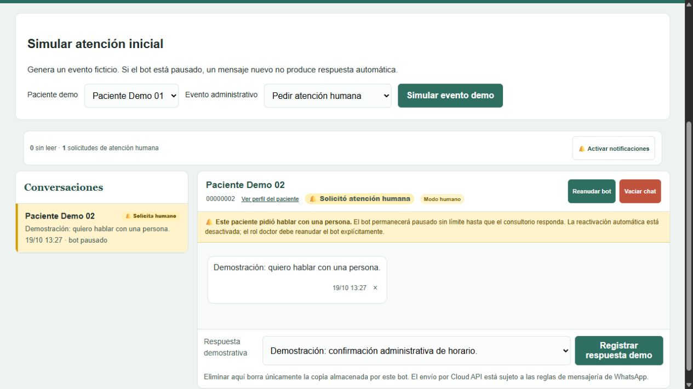

# ESCULAPIO · Agenda y operación administrativa

**Desarrollo backend · Python · FastAPI · SQLAlchemy · SQLite · Jinja**

[Probar demo](https://wunsce-esculapio-production.up.railway.app/demo) · [Aplicación](app/main.py) · [Reservas](app/scheduler.py) · [Pruebas de servicios](tests/test_services.py)



## Problema

Coordinar una agenda y las solicitudes de atención exige mantener consistencia entre horarios, permisos y conversación. Una reserva concurrente o un cambio de estado inesperado puede alterar el flujo administrativo.

## Implementación

- Agenda y reprogramación con restricciones, transacciones y detección de versiones desactualizadas.
- Roles y controles de acciones en servidor; la demo permite explorar roles simulados.
- Pausa de respuestas automáticas al solicitar atención humana y reanudación explícita por el rol autorizado.
- Base temporal por sesión, alias ficticios, PDF de agenda y adaptador de mensajería desactivado en la demo.

## Evidencia y decisiones

La suite de la incorporación aprobó **74 casos**, incluidos reservas concurrentes, permisos, citas desactualizadas y conservación de pausas manuales. Los transportes externos se prueban con respuestas simuladas. [Alcance de validación](../../VALIDACION.md).

La demo separa los espacios de cada visitante y limita las entradas administrativas. La selección pública de rol permite explorar la interfaz; no representa autenticación de una clínica real.

**Límite:** no contiene pacientes reales ni realiza envíos externos. La integración con un proveedor, la operación privada y sus requisitos necesitan verificaciones propias. No es una aplicación diagnóstica ni un expediente clínico.

## Ejecutar localmente

Python 3.12 recomendado. Cada aplicación es independiente: no mezclar sus dependencias ni importar sus módulos desde la raíz.

```bash
cd proyectos/esculapio
python -m venv .venv
# Activar .venv según el sistema
python -m pip install -r requirements-dev.txt
python -m pytest -q
python -m uvicorn app:app --host 127.0.0.1 --port 8000
```

Abrir http://127.0.0.1:8000. Consultar [OPERACION](OPERACION.md) para variables, arquitectura, recursos y límites. El Dockerfile se construye desde esta carpeta; no se activan despliegues desde este repositorio.

## Procedencia y aportación

Implementación del ecosistema WUNSCE del archivo personal del titular. Se incorpora una sola versión de sus fuentes, interfaz, recursos de marca, ejemplos sintéticos y pruebas. La organización, revisión y preparación pública tuvieron asistencia de Codex; no se atribuye autoría exclusiva sobre dependencias o componentes de terceros. No se copiaron bases, credenciales, adjuntos ni archivos de configuración privados.

La validación local no equivale a un despliegue nuevo, una certificación de seguridad ni un resultado comercial. Las integraciones externas no se acreditan por pruebas simuladas.

[Volver al portafolio](../../README.md)
