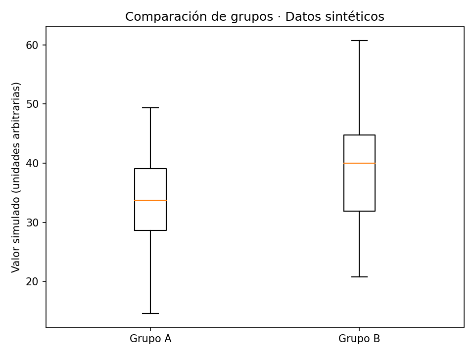

# Estadística aplicada: comparación de dos grupos

Estudio de comparación de tiempos con estadística descriptiva, normalidad, homogeneidad de varianzas y pruebas de hipótesis. La demostración usa datos sintéticos; no reproduce resultados clínicos.

**Área:** Analítica de datos · **Estado:** Demo con datos sintéticos

## Entorno

Python 3.10 o posterior. Crea un entorno virtual e instala `requirements.txt` desde esta carpeta. Las dependencias históricas no se han fijado a versiones comprobadas. Tkinter puede requerir un paquete del sistema.

## Uso

```bash
python demo.py
```

## Alcance y limitaciones

La elección de una prueba exige conocer el diseño del estudio. Las observaciones originales de Joyce no se distribuyen porque su procedencia no se confirmó.

## Vista de la demo



La demo se ejecutó con semilla fija. Esta figura no contiene datos clínicos.

## Siguiente desarrollo

Añadir intervalos de confianza, tamaños del efecto y una explicación de muestras independientes frente a pareadas.

[Volver al portafolio](../../README.md)
